  &nbsp;
  

## 🧰 &nbsp;Toolbox

  &nbsp;
  &nbsp;
  &nbsp;
  &nbsp;
  &nbsp;
  &nbsp;
  &nbsp;
  &nbsp;
  &nbsp;
  &nbsp;

&nbsp;

## 🐍 &nbsp;Contributions

<picture>
  <source media="(prefers-color-scheme: dark)" srcset="https://raw.githubusercontent.com/EmanuelTurko/EmanuelTurko/output/github-snake-dark.svg" />
  <source media="(prefers-color-scheme: light)" srcset="https://raw.githubusercontent.com/EmanuelTurko/EmanuelTurko/output/github-snake.svg" />
  
</picture>

&nbsp;

## 🚀 &nbsp;What I've built

| Project | What it does | Stack |
|:--|:--|:--|
| [**compiler**](https://github.com/EmanuelTurko/compiler) | Compiles a C-like language to x86-64 assembly. Lexer, recursive-descent parser, AST, codegen for functions, loops and scopes. | `C++20` `x86-64` |
| [**redis**](https://github.com/EmanuelTurko/redis) | In-memory key-value server. `poll()` event loop, progressive-rehash hashtable, AVL sorted sets, TTL heap, thread pool. | `C++17` `TCP` |
| [**site**](https://github.com/EmanuelTurko/site) | My portfolio site, with an HTTP backend in C++ on Boost.Asio/Beast. | `C++` `Boost` |
| [**SafeHer**](https://github.com/EmanuelTurko/SafeHer) | IoT safety pendant (B.Sc. capstone). ESP32-S3 camera firmware and BLE to Android. | `C++` `ESP32` |

&nbsp;

## 📊 &nbsp;Stats

  

